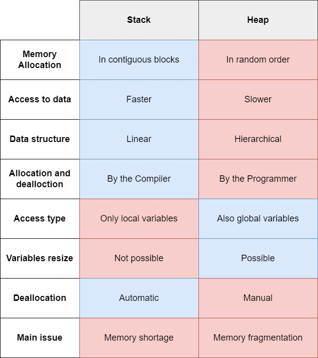

# C++ Memory Management

## Links

- [memory-management](https://www.programiz.com/cpp-programming/memory-management)
- [memory-layout-of-c-program](https://www.geeksforgeeks.org/memory-layout-of-c-program)
