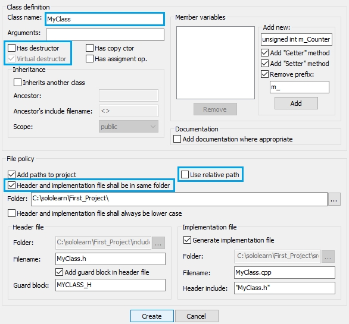
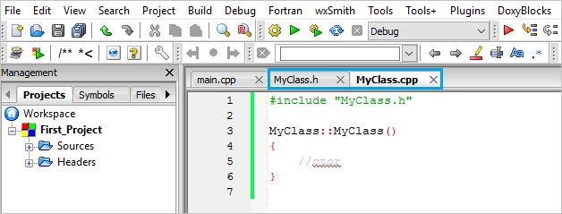

# C++ with CodeBlocks

## Creating a New Class

- It is generally a good practice to define your new classes in separate files. This makes maintaining and reading the code easier.
- To do this, use the following steps in CodeBlocks:
  **Click File->New->Class...** 
- Give your new class a name, uncheck "Has destructor" and check "Header and implementation file shall be in same folder", then click the **"Create"** button.
  
- Note that **two new files** have been added to your project:
  
- The new files act as templates for our new class.
  - **MyClass.h** is the **header** file.
  - **MyClass.cpp** is the **source** file.
## Source & Header

- The header file (.h) holds the function declarations (prototypes) and variable declarations. It currently includes a template for our new **MyClass** class, with one default constructor.
- **MyClass.h**
  ```C++
  #ifndef MYCLASS_H
  #define MYCLASS_H
  
  class MyClass
  {
    public:
      MyClass();
    protected:
    private:
  };
  
  #endif // MYCLASS_H
  ```
- The implementation of the class and its methods go into the source file (.cpp). Currently it includes just an empty constructor.
- **MyClass.cpp**
  ```C++
  #include "MyClass.h"
  
  MyClass::MyClass()
  {
     //ctor
  }
  ```
- The **double colon** `::` in the source file (.cpp) is called the <mark>**scope resolution operator**</mark>, and it's used for the function definition.
- The scope resolution operator is used to define a particular class' member functions, which have already been declared.