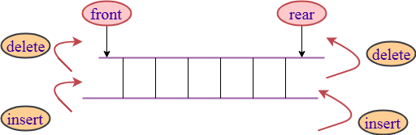
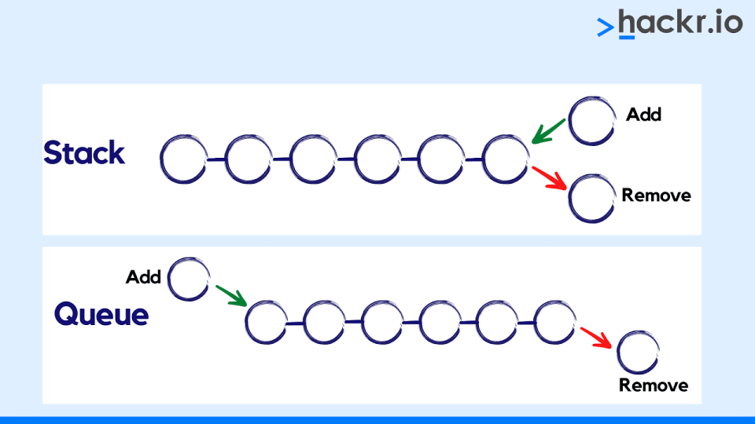

# Link
- https://www.geeksforgeeks.org/deque-cpp-stl
---
# Notes
- A deque (**double-ended queue**) is similar to a queue, but with flexible access at both ends. <mark>**Deques allow both FIFO and LIFO (last-in-first-out) operations**</mark>. Elements can be added or removed from both front and back. This provides more flexible access patterns.
	
	