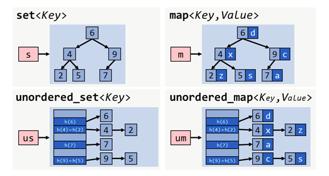

# set vs unordered_set in C++ STL

## Links
- https://www.geeksforgeeks.org/set-vs-unordered_set-c-stl
- https://www.geeksforgeeks.org/introduction-to-set-data-structure/#1-set-in-c
- https://www.youtube.com/watch?v=Yg7dpbXhhlY
---
## Notes
