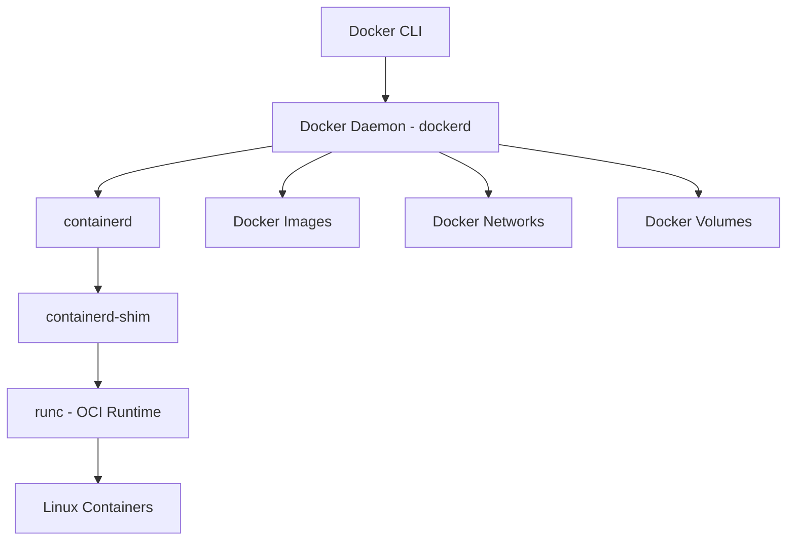
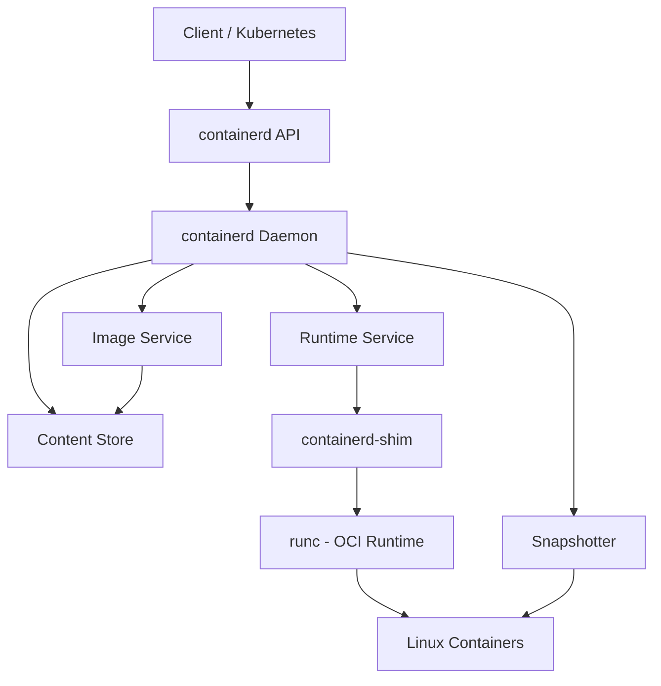
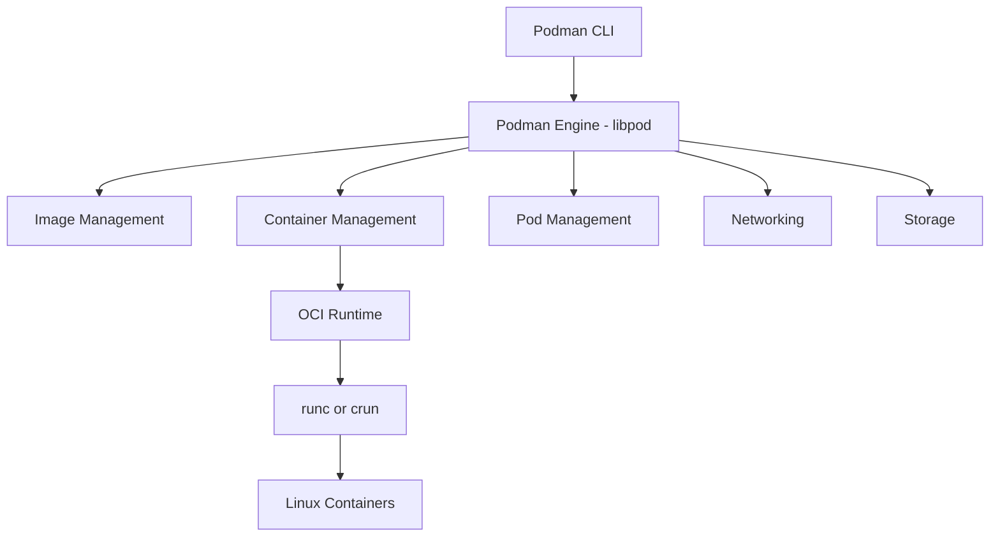
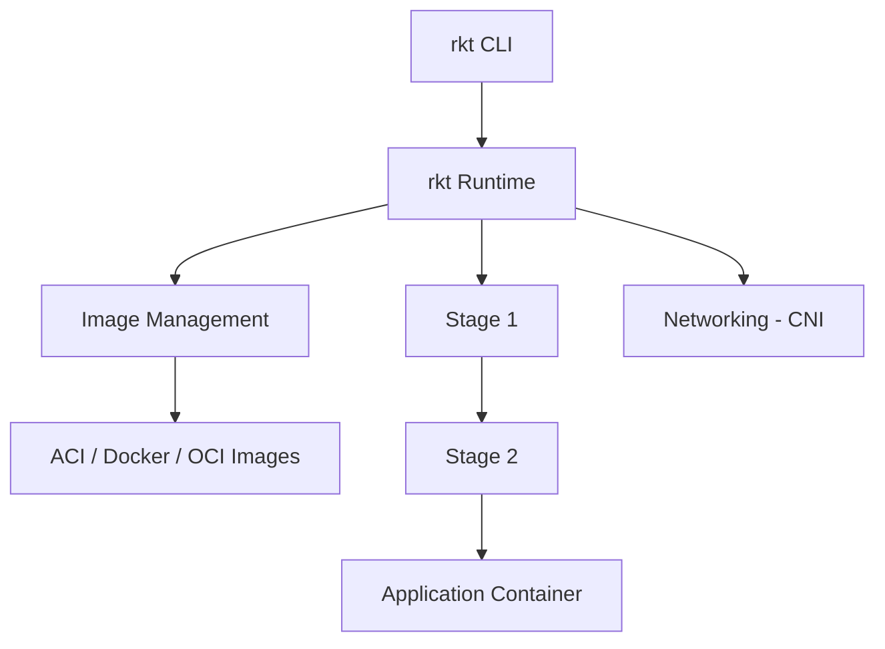

# Difference Between rkt vs Docker vs containerd vs Podman

<!--toc:start-->

- [Difference Between rkt vs Docker vs containerd vs Podman](#difference-between-rkt-vs-docker-vs-containerd-vs-podman)
  - [rkt](#rkt)
  - [Docker](#docker)
  - [containerd](#containerd)
  - [Podman](#podman)
  - [Difference Between rkt, Docker, containerd, and Podman](#difference-between-rkt-docker-containerd-and-podman)
  - [Architecture Comparison](#architecture-comparison)
    - [Docker Architecture](#docker-architecture)
    - [containerd Architecture](#containerd-architecture)
    - [Podman Architecture](#podman-architecture)
    - [rkt Architecture](#rkt-architecture)
  - [Main Differences Explained](#main-differences-explained)
    - [Docker vs containerd](#docker-vs-containerd)
    - [Docker vs Podman](#docker-vs-podman)
    - [rkt vs Podman](#rkt-vs-podman)
    - [containerd vs Podman](#containerd-vs-podman)
  - [Conclusion](#conclusion)

<!--toc:end-->

## rkt

**rkt** (pronounced "rocket") was an open-source container runtime developed by CoreOS for running application containers on Linux.

Its main focus was security, simplicity, and composability. It supported the App Container (appc) specification, the Container Network Interface (CNI), and could run Docker and OCI images.

Key features:

- Designed with a security-first approach.
- Supported running containers without root privileges.
- Used a modular architecture.
- Supported Docker and OCI images.
- Focused on secure and isolated application execution.

> [!NOTE]
> rkt is discontinued and is no longer actively maintained.

## Docker

**Docker** is an open-source platform used to build, package, distribute, and run containerized applications.

It allows developers to package applications and their dependencies into containers, making them portable across different environments.

Key features:

- Provides tools to build and manage container images.
- Uses Dockerfiles to define application environments.
- Supports container networking and persistent storage.
- Provides Docker Hub and private registries for sharing images.
- Offers an easy-to-use CLI and ecosystem.
- Commonly uses containerd and OCI-compatible runtimes under the hood.

## containerd

**containerd** is an industry-standard container runtime responsible for managing the container lifecycle.

It handles tasks such as pulling images, managing storage, creating containers, and running containers. It is commonly used underneath Docker and Kubernetes.

Key features:

- Manages the complete container lifecycle.
- Pulls and manages container images.
- Supports OCI-compliant images and runtimes.
- Provides a modular and extensible architecture.
- Supports container management through APIs.
- Can be used directly without Docker.
- Commonly integrates with Kubernetes through CRI-compatible components.

## Podman

**Podman** is an open-source container management tool developed by Red Hat.

It provides a Docker-compatible command-line experience for building, running, and managing containers. Unlike traditional Docker Engine usage, Podman does not require a central daemon.

Key features:

- Daemonless container architecture.
- Supports rootless containers.
- Compatible with Docker commands and OCI images.
- Supports pods, allowing multiple containers to work together.
- Provides container image building and management.
- Integrates with systemd.
- Commonly used as an alternative to Docker.

## Difference Between rkt, Docker, containerd, and Podman

| Comparison            | rkt                     | Docker                           | containerd                              | Podman                          |
| --------------------- | ----------------------- | -------------------------------- | --------------------------------------- | ------------------------------- |
| **Type**              | Container runtime       | Container platform               | Container runtime                       | Container management tool       |
| **Developer**         | CoreOS                  | Docker, Inc.                     | Originally Docker                       | Red Hat                         |
| **Main Purpose**      | Security and simplicity | Building and managing containers | Container lifecycle management          | Daemonless container management |
| **Maintenance**       | Discontinued            | Actively maintained              | Actively maintained                     | Actively maintained             |
| **Rootless Support**  | Supported               | Supported                        | Depends on configuration and runtime    | Supported                       |
| **Architecture**      | Modular                 | Integrated ecosystem             | Modular                                 | Daemonless                      |
| **Image Format**      | appc and OCI            | OCI-compatible                   | OCI-compatible                          | OCI-compatible                  |
| **Networking**        | CNI                     | Built-in container networking    | External networking components          | Container networking            |
| **Docker Dependency** | Independent             | Uses containerd internally       | Independent of Docker                   | Independent of Docker           |
| **Common Usage**      | Historical interest     | Development and deployment       | Container infrastructure and Kubernetes | Docker alternative              |

## Architecture Comparison

### Docker Architecture

Docker uses a client-server architecture. The Docker CLI communicates with the Docker daemon, which delegates container lifecycle operations to containerd. containerd uses an OCI runtime such as runc to create and run containers.

### containerd Architecture

containerd manages container images, storage, and container lifecycle operations. It can be used independently of Docker and is commonly used in Kubernetes environments.

### Podman Architecture

Podman uses a daemonless architecture. The Podman CLI directly interacts with its container management library and uses an OCI runtime such as runc or crun to run containers.

### rkt Architecture

rkt used a modular architecture based on stages. Stage 1 prepared the container environment, while Stage 2 executed the application.

> [!NOTE]
> rkt has been discontinued, so this architecture is included for historical and educational purposes.

## Main Differences Explained

### Docker vs containerd

- Docker is a complete container development and management ecosystem.
- containerd focuses specifically on managing container lifecycles.
- Docker uses containerd internally.
- containerd can operate independently of Docker.

### Docker vs Podman

- Docker traditionally uses a central daemon (`dockerd`).
- Podman uses a daemonless architecture.
- Both support OCI container images.
- Podman supports rootless containers as a core feature.
- Podman offers a largely Docker-compatible CLI.

### rkt vs Podman

- Both emphasize container security.
- rkt was developed by CoreOS, while Podman was developed by Red Hat.
- Both support running containers without root privileges.
- rkt is discontinued, whereas Podman is actively maintained.

### containerd vs Podman

- containerd is primarily a container runtime.
- Podman is a higher-level container management tool.
- containerd is commonly used underneath Kubernetes.
- Podman provides commands for building, running, and managing containers.

## Conclusion

| Technology | Recommended Use                                                    |
| ---------- | ------------------------------------------------------------------ |
| rkt        | Historical learning and understanding container technology         |
| Docker     | Application development, image building, and local development     |
| containerd | Container infrastructure and Kubernetes environments               |
| Podman     | Rootless containers, daemonless workflows, and Docker alternatives |

> [!IMPORTANT]
> Docker, containerd, and Podman are not exactly direct alternatives. Docker and Podman provide higher-level container management experiences, while containerd focuses on the underlying container lifecycle. rkt is primarily of historical interest today.
