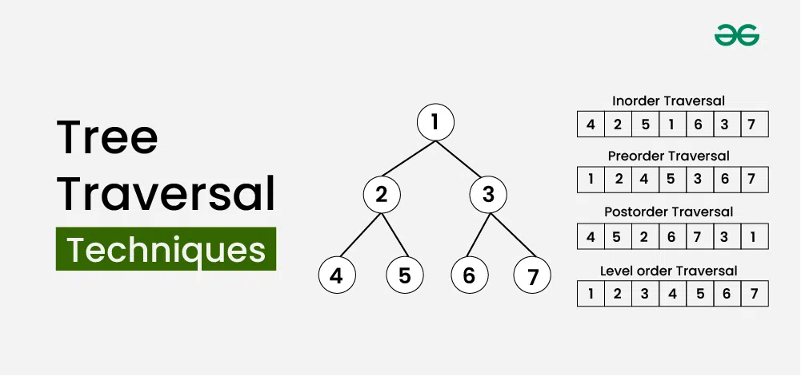
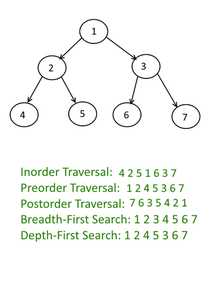

# Binary Search Tree (BST) Traversals – Inorder, Preorder, Post Order

## Links

- [geeksforgeeks](https://www.geeksforgeeks.org/binary-search-tree-traversal-inorder-preorder-post-order/)
- [C++ Program binary tree traversal preorder inorder postorder](https://www.youtube.com/watch?v=QAEI6yksD6M)

---

## Notes

- A **BST** is defined as follows:
  - The left subtree of a node contains only nodes with keys **less than** the node's key.
  - The right subtree of a node contains only nodes with keys **greater than** the node's key.
  - Both the left and right subtrees must also be binary search trees.
