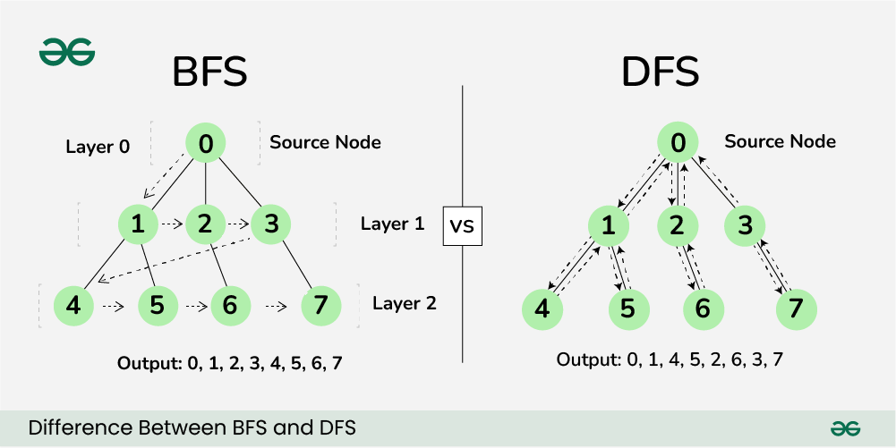
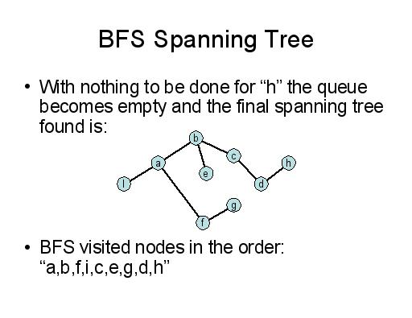
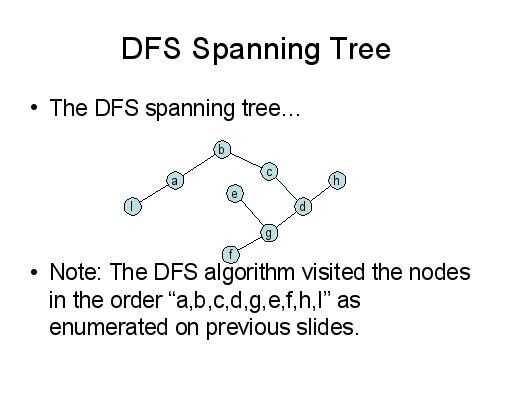

# Depth First Search (DFS) && Breadth First Search (BFS)

## Links

- https://www.geeksforgeeks.org/depth-first-search-or-dfs-for-a-graph
- https://www.geeksforgeeks.org/breadth-first-search-or-bfs-for-a-graph
- [Spanning Tree](https://www.geeksforgeeks.org/spanning-tree)
- https://www.programiz.com/dsa/graph-dfs
- [5.1 Graph Traversals - BFS & DFS -Breadth First Search and Depth First Search](https://www.youtube.com/watch?v=pcKY4hjDrxk)

---

## Notes

- Binary Tree is also a Graph
- BFS is like the level-order traversal (BST)
- DFS is like the pre-order traversal (BST)
- **Difference between BFS and DFS**
  
  
  
