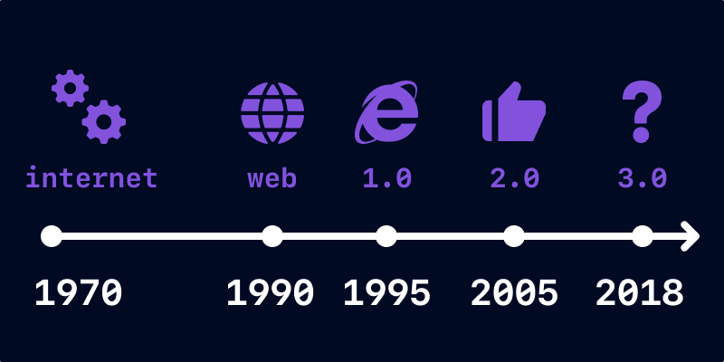
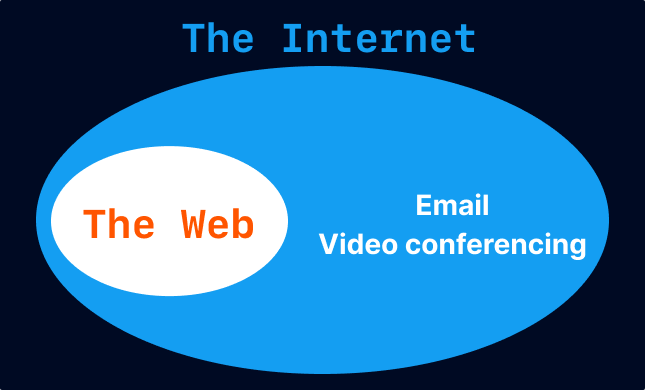
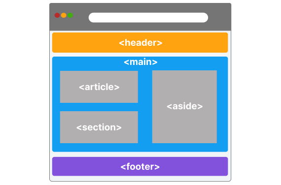
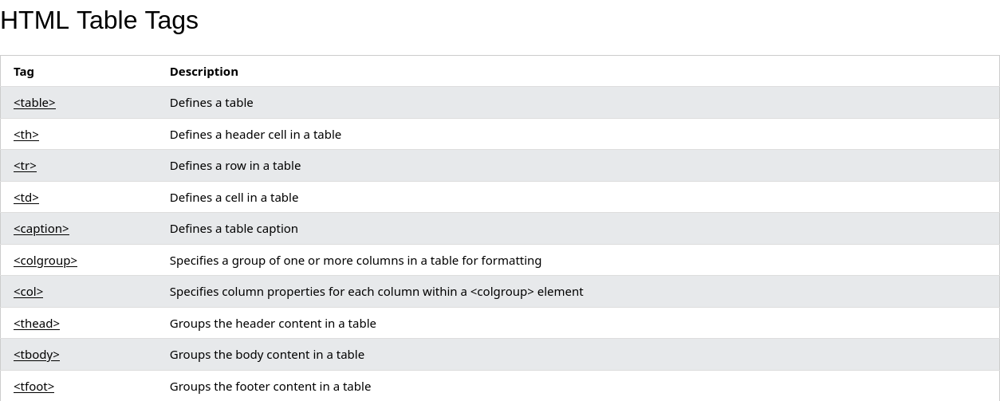

# HTML Notes

- HyperText Markup Language (HTML) is the language websites are written in. Elements (also known as tags) are the building blocks of HTML pages and tells the browser how to display content.
- Grouping different HTML elements can make your pages faster to load and easier to customize and maintain.
- **Did you know? :** The web was originally designed and developed at the European Organization for Nuclear Research (CERN) in the '90s. The first prototype enabled scientists to share information between different universities and research institutes around the world.
  
  
-

## HTML Structure

- The HTML structure (as shown in the screenshot) has the following components:
  - The `<!DOCTYPE html>` defines that the page is a HTML5 document. This helps with standardisation across different browsers and tells the browser to use HTML5 to interpret the page.
  - The `<html>` element is the root element of the HTML page - all other elements come after this element.
  - The `<head>` element contains information about the page (such as the page title)
  - The `<body>` element defines the HTML document's body; only content inside of the body is shown in the browser.
  - The `<h1>` element defines a large heading
  - The `<p>` element defines a paragraph
  - There are many other elements (tags) used for different purposes. For example, there are tags for buttons (`<button>`), images (``), lists, and much more.

## **video**

- You can add video files in different formats. Common video formats are: MP4, OGG and WebM.
- The <source> empty tag provides the location and format of the video file:

  ```html
  <video controls>
    <source src="file.mp4" type="video/mp4" />
  </video>
  ```

- When different <source> options are included, the browser will choose the first one it supports.
- You can add text between the `<video>` tags. The text will only be displayed in browsers that don’t support the video element.
- You can display play/pause, volume and other video controls with the **controls** attribute.
  ⭐ The **`<video>`** tag embeds video in web pages
  ⭐ The **<source>** tag lets you add multiple media files
  ⭐ The **controls** attribute adds default video controls

---

## **Audio**

- You can embed audio files into web pages with the **`<audio>` container tag**.
- Just like video, the **<source> tag** is used to add source options for audio.
- The `<source>` tag is an empty tag.
- Just like video, the **src attribute** adds the audio file URL. The **type attribute** adds the format.
- You can use **autoplay, muted** and **loop** attributes to control the behavior of the multimedia element. Just like **controls,** these attributes have their default values omitted.
  ⭐ The `<audio>` tag embeds sound into a web page
  ⭐ The autoplay, muted and loop attributes control how the multimedia behaves

---

## Page Layout

- The layout of a web page can improve user experience and make the content more readable.
- The header often contains navigation links, a menu and/or a search bar. Brand elements like logos are usually found in the header too.

  ```html
  <header>
    <!--Introductory information-->
  </header>
  ```

  **Note:** You can add several header elements to a web page.

- The `<main>` container tag is used to include the main content of a web page.

  ```html
  <main>
    <!--main content-->
  </main>
  ```

  **Note:** There must not be more than one `<main>` element in a document.

- The **`<footer>`** container tag often contains contact and legal information and links.

  ```html
  <footer>
    <!--footer information-->
  </footer>
  ```

  **Note:** You can have several `<footer>` elements in one document.

- `<header>`, `<main>` and `<footer>` elements are nested inside the `<body>` container tag
  
- **`<article>`** represents an independent, self-contained piece of content. This tag clearly indicates the role for its content. It’s used for content like news stories, and blog posts.
- **`<section>`** helps to break down the content into parts.
- **`<aside>`** is used for secondary, additional or somehow related content.
  --> You can combine these elements to create a well-structured semantic layout for your content.
  --> Semantic tags don’t give any visual effect to the content. You can nest layout elements to create organized and accessible pages.
  ⭐ `<article>` represents a self-contained, independent piece of content
  ⭐ `<section>` is used to divide content into parts
  ⭐ `<aside>` is used for secondary, additional or somehow related content

---

## Forms

- An HTML form is used to collect user input. The user input is most often sent to a server for processing (using the PHP).
- The HTML `<form>` element is used to create an HTML form for user input.
- The HTML `<input>` element is the most used form element. An `<input>` element can be displayed in many ways, depending on the `type` attribute ([more info](https://www.w3schools.com/html/html_forms.asp)).
- **Note:** The form itself is not visible. Also note that the default width of an input field is 20 characters.
- Notice that each input field must have a `name` attribute to be submitted.
- **Note:** If the `name` attribute is omitted, the value of the input field will not be sent at all.

### Form Attributes

- The `action` attribute defines the action to be performed when the form is submitted. Usually, the form data is sent to a file on the server when the user clicks on the submit button.

```html
<form action="/action_page.php">
  <label for="fname">First name:</label><br />
  <input type="text" id="fname" name="fname" value="John" /><br />
  <label for="lname">Last name:</label><br />
  <input type="text" id="lname" name="lname" value="Doe" /><br /><br />
  <input type="submit" value="Submit" />
</form>
```

- **Tip:** If the `action` attribute is omitted, the action is set to the current page.

#### Target Attribute

- The `target` attribute specifies where to display the response that is received after submitting the form (_blank, \_self, \_parent, \_top, \_framename_). The default value is `_self` which means that the response will open in the current window.

```html
<form action="/action_page.php" target="_blank"></form>
```

#### Method Attribute

- The `method` attribute specifies the HTTP method to be used when submitting the form data.
- The form-data can be sent as URL variables (with `method="get"`) or as HTTP post transaction (with `method="post"`).
- The default HTTP method when submitting form data is GET.
- **Notes on GET:**
  - Appends the form data to the URL, in name/value pairs
  - NEVER use GET to send sensitive data! (the submitted form data is visible in the URL!)
  - The length of a URL is limited (2048 characters)
  - Useful for form submissions where a user wants to bookmark the result
  - GET is good for non-secure data, like query strings in Google
- **Notes on POST:**
  - Appends the form data inside the body of the HTTP request (the submitted form data is not shown in the URL)
  - POST has no size limitations, and can be used to send large amounts of data.
  - Form submissions with POST cannot be bookmarked
- **Tip:** Always use POST if the form data contains sensitive or personal information!

#### Autocomplete Attribute

- The `autocomplete` attribute specifies whether a form should have autocomplete on or off.
- When autocomplete is on, the browser automatically complete values based on values that the user has entered before.

```html
<form action="/action_page.php" autocomplete="on"></form>
```

#### Novalidate Attribute

- The `novalidate` attribute is a boolean attribute.
- When present, it specifies that the form-data (input) should not be validated when submitted.

### The HTML `<form>` Elements

- The HTML `<form>` element can contain one or more of the following form elements:
  - `<input>`
  - `<label>`
  - `<select>`
  - `<textarea>`
  - `<button>`
  - `<fieldset>`
  - `<legend>`
  - `<datalist>`
  - `<output>`
  - `<option>`
  - `<optgroup>`
- [More info](https://www.w3schools.com/html/html_form_elements.asp)

---

## HTML Block and Inline Elements

- Every HTML element is either **inline** or **block**.
  - **Block-level** elements always start on a new line.
  - **Inline** elements don't start on a new line.
- Inline elements can be nested inside block-level elements.

---

## HTML Semantic Elements

- A semantic element clearly describes its meaning to both the browser and the developer.
  - Examples of **non-semantic** elements: `<div>` and `<span>` - Tells nothing about its content.
  - Examples of **semantic** elements: `<form>`, `<table>`, and `<article>` - Clearly defines its content.

---

## HTML Tables

- HTML tables allow web developers to arrange data into rows and columns.
- A table in HTML consists of table cells inside rows and columns.
- Each table cell is defined by a `<td>` and a `</td>` tag.
- `td` stands for table data.
- Each table row starts with a `<tr>` and ends with a `</tr>` tag.
- `tr` stands for table row.
- Sometimes you want your cells to be table header cells. In those cases use the `<th>` tag instead of the `<td>` tag.
- `th` stands for table header.
- **Note:** A table cell can contain all sorts of HTML elements: text, images, lists, links, other tables, etc.

```html
<table>
   
  <tr>
       
    <th>Person 1</th>
       
    <th>Person 2</th>
       
    <th>Person 3</th>
     
  </tr>
   
  <tr>
       
    <td>Emil</td>
       
    <td>Tobias</td>
       
    <td>Linus</td>
     
  </tr>
   
  <tr>
       
    <td>16</td>
       
    <td>14</td>
       
    <td>10</td>
     
  </tr>
</table>
```

- By default, the text in `<th>` elements are bold and centered, but you can change that with CSS.
- **HTML Table Tags :**
  

### HTML Table Tags

- **colspan** is for the number of columns a cell should span.
- The **rowspan** attribute specifies the number of rows a cell should span. You can use rowspan to merge cells vertically.

