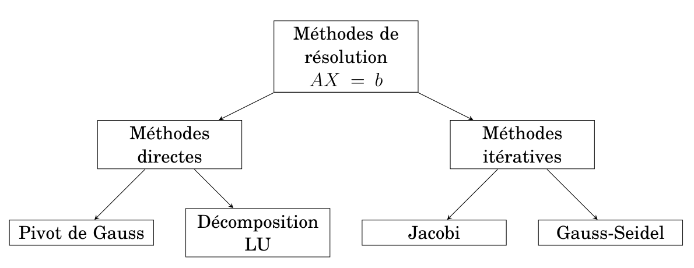
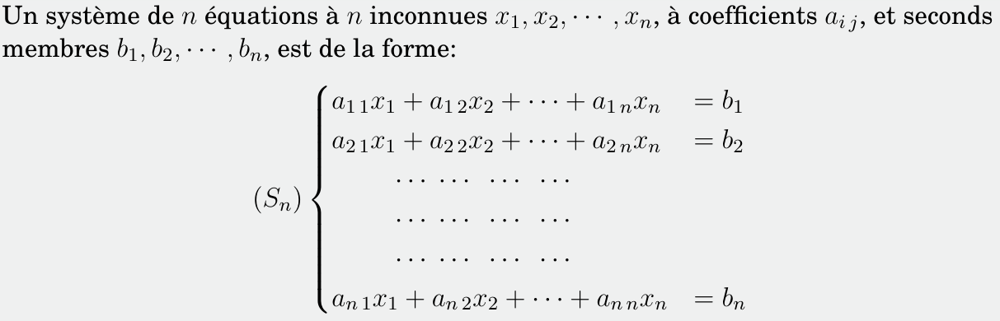
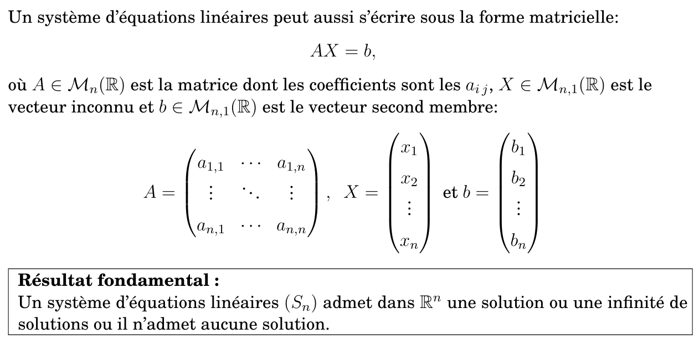
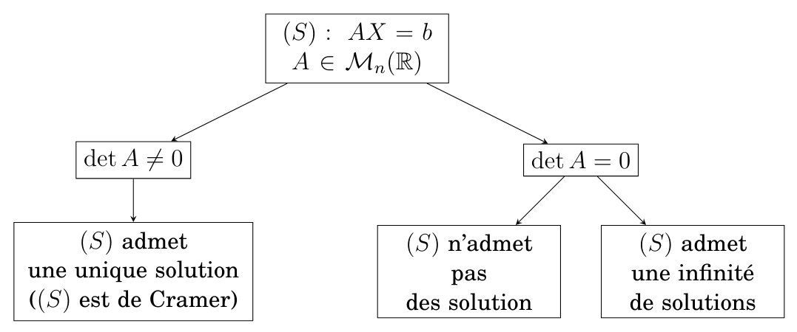

# Résolution numérique de systèmes d’équations linéaires Resume

## Introduction

### les méthodes de résolution pour des systèmes d’équations linéaires



### Système d’équations linéaires



### Forme matricielle d’un système linéaire



### Existence des solutions



> [!NOTE]
> (A) matrice carrée, si $\det(A) \neq 0$ $\Leftrightarrow$
>
> - $A$ est **inversible**
> - le système linéaire $(S)$ est un **système de Cramer**
> - $(S)$ admet une **solution unique**
> - les colonnes (ou lignes) de $A$ sont **linéairement indépendantes**
> - $\mathrm{rang}(A) = n$ (rang maximal)
> - l’application linéaire associée est **bijective**

```python
import numpy as np

def tridiag(a1, a2, a3, n):
    """
    Construct a tridiagonal linear system A X = b.

    Parameters
    ----------
    a1 : float
        Main diagonal value
    a2 : float
        Upper diagonal value
    a3 : float
        Lower diagonal value
    n : int
        Size of the system

    Returns
    -------
    A : np.ndarray
        Tridiagonal matrix (n x n)
    b : np.ndarray
        Right-hand side vector (n, 1)
    """
    A = (
        a1 * np.eye(n) +
        a2 * np.diag(np.ones(n - 1), 1) +
        a3 * np.diag(np.ones(n - 1), -1)
    )

    b = 2 * np.ones((n, 1))

    return A, b
```

## Normes vectorielles et matricielles

### Normes vectorielles

Une norme sur $\mathbb{R}^n$ est une application $\lVert \cdot \rVert: \mathbb{R}^n \to \mathbb{R}^+$ satisfaisant les propriétés suivantes:

1. (**Définie positivité**) : pour tout $x \in \mathbb{R}^n$,
   $\lVert x \rVert = 0 \Rightarrow x = 0_{\mathbb{R}^n}$
2. (**Homogénéité**) : pour tout $x \in \mathbb{R}^n$, pour tout $\lambda \in \mathbb{R}$,
   $\lVert \lambda x \rVert = |\lambda|.\lVert x \rVert$
3. (**Inégalité triangulaire**) : pour tous $x, y \in \mathbb{R}^n$,
   $\lVert x + y \rVert \leq \lVert x \rVert + \lVert y \rVert$

Les normes vectorielles usuelles que l’on utilisera le plus souvent sont:

Soit $x = (x_i)_{1 \le i \le n} \in \mathbb{R}^n$ :

- **Norme 1 (norme de Manhattan)** :
  $$
  \lVert x \rVert_1 = \sum_{i=1}^{n} |x_i| = |x_1| + |x_2| + \cdots + |x_n|
  $$
- **Norme euclidienne (norme 2)** :
  $$
  \lVert x \rVert_2 = \left( \sum_{i=1}^{n} |x_i|^2 \right)^{1/2}
  = \sqrt{|x_1|^2 + |x_2|^2 + \cdots + |x_n|^2}
  $$
- **Norme infinie (norme du sup)** :
  $$
  \lVert x \rVert_\infty = \max_{1 \le i \le n} |x_i|
  = \max \{ |x_1|, |x_2|, \cdots, |x_n| \}
  $$

### Normes matricielles subordonnées

#### Définition d’une norme matricielle

On appelle norme matricielle sur $\mathbb{R}^n$ toute application $\lVert \cdot \rVert$ définie sur $\mathbb{R}^n$ à valeurs dans $\mathbb{R}^+$, vérifiant pour tout $A, B \in \mathcal{M}_n(\mathbb{R})$, et pour tout $\lambda \in \mathbb{R}$:

1. $\lVert A \rVert = 0 \Rightarrow A = O_n$, où $O_n$ est la matrice nulle d’ordre $n$
2. $\lVert \lambda A \rVert = |\lambda|.\lVert A \rVert$
3. $\lVert A + B \rVert \leq \lVert A \rVert + \lVert B \rVert$
4. $\lVert AB \rVert \leq \lVert A \rVert.\lVert B \rVert$

#### Définition d’une norme matricielle subordonnées

Toute norme vectorielle de $\mathbb{R}^n$ définit une norme matricielle de la façon suivante:

$$
\forall A \in \mathcal{M}_n(\mathbb{R}), \quad
\lVert A \rVert = \sup_{x \in \mathbb{R}^n, x \neq 0} \frac{\lVert Ax \rVert}{\lVert x \rVert}
= \sup_{\lVert x \rVert = 1} \lVert Ax \rVert
$$

est dite **norme matricielle subordonnée** (ou **induite à une norme vectorielle**).
On notera $\lVert \cdot \rVert_p$ la norme matricielle subordonnée associée à la norme vectorielle d’indice $p$, avec $p = 1, 2, \infty$.

#### Normes matricielles usuelles

> [!NOTE]
> Soit $A \in \mathbb{R}^{n\times n}$.
>
> - $\lVert A \rVert_{1} = \displaystyle \sup_{x \neq 0} \frac{\lVert Ax \rVert_{1}}{\lVert x \rVert_{1}} = \max_{j} \sum_{i} |a_{ij}|$
>   (somme maximale des **colonnes**)
> - $\lVert A \rVert_{\infty} = \displaystyle \sup_{x \neq 0} \frac{\lVert Ax \rVert_{\infty}}{\lVert x \rVert_{\infty}} = \max_{i} \sum_{j} |a_{ij}|$
>   (somme maximale des **lignes**)
> - $\lVert A \rVert_{2} = \sqrt{\rho(AA^{\top})}$
>   où $\rho(B) = \max{|\lambda|; \lambda \text{ valeur propre de } B}$ et $\rho$ rayon spectral
>
> **Cas particulier :**
>
> - Si $A$ est **symétrique** ($A = A^{\top}$) :
>   $$
>   |A|_{2} = \sqrt{\rho(A^2)} = |\lambda_{\max}| = \rho(A)
>   $$
>   (la norme 2 est la **plus grande valeur absolue des valeurs propres** de $A$)

> [!NOTE]
> Soit $A \in \mathbb{R}^{n\times n}$, et $\lambda \in \mathbb{R}$.
>
> - On dit que $\lambda$ est une **valeur propre** de $A$ s’il existe un vecteur
>   $v \in \mathbb{R}^n$, avec $v \neq 0$, tel que: $Av = \lambda v$
> - $\lambda$ est une **valeur propre** de $A$ $\Leftrightarrow$
>   $\lambda$ est solution de l’équation: $\det(A - \lambda I_n) = 0$

## Méthode du pivot de Gauss

La méthode du pivot de Gauss consiste à transformer un système en un autre système **équivalent** (ayant les mêmes solutions) qui est **triangulaire** et donc facile à résoudre.

### Opérations autorisées pour transformer le système

- Permutation de deux lignes: $L_i \leftrightarrow L_j$
- Multiplication d’une ligne par un scalaire non nul: $L_i \gets \lambda L_i, \quad \lambda \neq 0$
- Addition d’un multiple d’une ligne à une autre: $L_i \gets L_i + \lambda L_j$

## Méthode de décomposition LU

Soit un système d’équations linéaires $S$ défini par:
$$(S) : AX = b$$
où $A$ est une matrice dont tous les mineurs principaux sont **non nuls**.

### Mineur principal

Soit $p \in \mathbb{N}^*$.
On appelle **mineur principal** $M_{p,p}$ de $A$ le déterminant de la sous-matrice de $A$ formée des $p$ premières lignes et des $p$ premières colonnes.

> [!TIP]
> Si $A$ est d’ordre $n$, alors elle admet exactement $n$ mineurs principaux $M_{1,1}, M_{2,2}, \dots, M_{n,n}$.

### Le principe de la méthode

1. On écrit: $A = LU$, où $L$ **est triangulaire inférieure** et $U$ **est triangulaire supérieure**.
2. On pose: $Y = UX$, d’où
   $AX = b\Longleftrightarrow LUX = b \Longleftrightarrow LY = b$
3. On résout successivement :
   1. **(Descente)** : résolution du système triangulaire inférieur $LY = b$
   2. **(Remontée)** : résolution du système triangulaire supérieur $UX = Y$
4. Ainsi, la résolution de $AX = b$ se ramène au système :
   $$
   \begin{cases}
   LY = b
   \\
   UX = Y
   \end{cases}
   $$

> [!TIP]
> La décomposition LU se fait à l’aide de l’élimination de Gauss.

### Théorème d’existence

Soit $A$ une matrice dont tous **les mineurs principaux sont non nuls**.

- Alors il $\exists$ deux matrices $L$ et $U$ telles que:
  - $L$ est **triangulaire inférieure** avec des coefficients diagonaux égaux à $1$
  - $U$ est **triangulaire supérieure**
- vérifiant:
  $$A = LU$$

### Matrice à diagonale strictement dominante

Soit $A = (a_{i,j})$ une matrice carrée d’ordre $n$.
On dit que $A$ est **à diagonale strictement dominante** si, pour tout $i \in \{1, \dots, n\}$:

$$
|a_{i,i}| > \sum_{\substack{j=1 \\ j \ne i}}^{n} |a_{i,j}|
$$

> [!TIP]
> Chaque coefficient diagonal est **strictement plus grand** (en valeur absolue)
> que la somme des autres coefficients de sa ligne.

> [!NOTE]
> Si A est une matrice à diagonale strictement dominante alors **elle admet une
> décomposition LU**.

```python
import numpy as np

def matrice_diag_dominante(A: np.ndarray) -> bool:
    """
    Vérifie si une matrice carrée A est à diagonale strictement dominante.

    Paramètres
    ----------
    A : np.ndarray
        Matrice carrée (n x n)

    Retour
    ------
    bool
        True si A est à diagonale strictement dominante, False sinon.
    """
    A = np.asarray(A)

    # Vérification que la matrice est carrée
    if A.ndim != 2 or A.shape[0] != A.shape[1]:
        raise ValueError("La matrice doit être carrée.")

    # Test de dominance diagonale stricte
    for i in range(A.shape[0]):
        if abs(A[i, i]) <= np.sum(np.abs(A[i, :])) - abs(A[i, i]):
            return False

    return True
```

## Méthode de Jacobi

La méthode itérative de Jacobi pour résoudre le système $(S) : AX = b$ consiste en premier lieu à décomposer $A$ sous la forme:

$$
A = D - E - F
$$

où $D$ est une matrice **diagonale**, $E$ est une matrice **triangulaire inférieure** et $F$ est une matrice **triangulaire supérieure**.

> [!NOTE]
> Si la suite $(X^{(k)})_{k \ge 0}$ est convergente, alors:
>
> $$
> \lim_{k \to +\infty} X^{(k)} = X
> $$
>
> avec $X$ l’unique solution du système $(S)$.

Le système $(S) : AX = b$ est alors équivalent à:

$$
X^{(k+1)}
= \underbrace{M^{-1} N}_{\text{matrice à appliquer à } X^{(k)}} X^{(k)}
+ \underbrace{M^{-1} b}_{\text{vecteur constant}}
$$

avec:

$$
M = D, \quad N = E + F
$$

Dans $\mathbb{R}^n$, les composantes $x_i^{(k+1)}$ ($i \in \{1, \dots, n\}$) du vecteur $X^{(k+1)}$ s’écrivent en fonction des composantes $x_j^{(k)}$ du vecteur $X^{(k)}$ comme suit :

$$
x_i^{(k+1)} = \frac{1}{a_{ii}} \left( b_i - \sum_{\substack{j=1 \\ j \neq i}}^{n} a_{ij} \, x_j^{(k)} \right),
\quad \forall i \in \{1, \dots, n\}.
$$

### Convergence de la méthode de Jacobi

Soit $A$ une **matrice à diagonale strictement dominante**. Alors la méthode de Jacobi appliquée au système $(S): AX = b$ est convergente vers la solution de $(S)$ pour tout $X^{(0)} \in \mathbb{R}^{n \times 1}$.

> [!NOTE]
> On peut considérer le critère d’arrêt suivant pour la méthode de Jacobi:
>
> $$
> \| A X^{(k)} - b \| \le \varepsilon,
> $$
>
> avec $\varepsilon$ très petit. On dit que $\varepsilon$ est une **tolérance**.

### Méthode de Jacobi (implémentation Python)

```python
import numpy as np

def jacobi(A: np.ndarray, b: np.ndarray, X0: np.ndarray, epsilon: float, max_iter: int = 1000):
    """
    Méthode de Jacobi pour résoudre AX = b.

    Paramètres
    ----------
    A : np.ndarray
        Matrice carrée (n x n)
    b : np.ndarray
        Vecteur second membre (n,)
    X0 : np.ndarray
        Approximation initiale
    epsilon : float
        Tolérance pour le critère d'arrêt
    max_iter : int
        Nombre maximum d'itérations

    Retour
    ------
    X : np.ndarray
        Solution approchée
    k : int
        Nombre d'itérations effectuées
    """
    A = np.asarray(A)
    b = np.asarray(b)
    X = np.asarray(X0, dtype=float)

    # Vérifications
    if A.shape[0] != A.shape[1]:
        raise ValueError("A doit être une matrice carrée.")
    if b.shape[0] != A.shape[0]:
        raise ValueError("Dimensions incompatibles entre A et b.")
    if not matrice_diag_dominante(A):
        raise ValueError("A n'est pas à diagonale strictement dominante.")

    # Décomposition
    D = np.diag(np.diag(A))
    R = A - D  # équivaut à -(E+F)

    D_inv = np.diag(1 / np.diag(D))  # inversion rapide

    k = 0
    while np.linalg.norm(A @ X - b) > epsilon and k < max_iter:
        X = D_inv @ (b - R @ X)
        k += 1

    return X, k
```

> [!NOTE]
> Pour résoudre directement le système linéaire $(S) : AX = b$, on utilise la fonction suivante:
>
> ```python
> X = np.linalg.solve(A, b)
> ```

## Méthode de Gauss-Seidel

Comme pour la méthode de Jacobi, la méthode de Gauss-Seidel pour la résolution d’un système d’équations linéaires $(S) : AX = b$ consiste en premier lieu à décomposer $A$ sous la forme :

$$
A = D - E - F
$$

où $D$ est une matrice diagonale, $E$ est une matrice triangulaire inférieure et $F$ est une matrice triangulaire supérieure.

Le système $(S) : AX = b$ est alors équivalent à:

$$
X^{(k+1)}
= \underbrace{M^{-1} N}_{\text{matrice à appliquer à } X^{(k)}} X^{(k)}
+ \underbrace{M^{-1} b}_{\text{vecteur constant}}
$$

avec:

$$
M = D - E, \quad N = F
$$

Dans $\mathbb{R}^n$, les composantes $x_i^{(k+1)}$ ($i \in \{1, \dots, n\}$) du vecteur $X^{(k+1)}$ s’écrivent en fonction des composantes $x_j^{(k)}$ du vecteur $X^{(k)}$ comme suit :

$$
x_i^{(k+1)} = \frac{1}{a_{ii}} \left(
b_i
- \sum_{j=1}^{i-1} a_{ij} x_j^{(k+1)}
- \sum_{j=i+1}^{n} a_{ij} x_j^{(k)}
\right),
\quad \forall i \in \{1, \dots, n\}.
$$

### Convergence de la méthode de Gauss-Seidel

Soit $A$ une **matrice à diagonale strictement dominante**. Alors la méthode de Gauss-Seidel appliquée au système $(S) : AX = b$ est convergente vers la solution de $(S)$ pour tout $X^{(0)} \in \mathbb{R}^{n \times 1}$.

> [!NOTE]
> Comme pour la méthode de Jacobi, on peut considérer le critère d’arrêt suivant pour la méthode de Gauss-Seidel :
>
> $$
> \| A X^{(k)} - b \| \le \varepsilon,
> $$
>
> avec la tolérance $\varepsilon$ assez petite.

### Méthode de Gauss-Seidel (implémentation Python)

```python
import numpy as np

def gauss_seidel(A: np.ndarray, b: np.ndarray, X0: np.ndarray, epsilon: float, max_iter: int = 1000):
    """
    Méthode de Gauss-Seidel pour résoudre AX = b.

    Paramètres
    ----------
    A : np.ndarray
        Matrice carrée (n x n)
    b : np.ndarray
        Vecteur second membre (n,)
    X0 : np.ndarray
        Approximation initiale
    epsilon : float
        Tolérance pour le critère d'arrêt
    max_iter : int
        Nombre maximum d'itérations

    Retour
    ------
    X : np.ndarray
        Solution approchée
    k : int
        Nombre d'itérations effectuées
    """
    A = np.asarray(A)
    b = np.asarray(b)
    X = np.asarray(X0, dtype=float)

    # Vérifications
    if A.shape[0] != A.shape[1]:
        raise ValueError("A doit être une matrice carrée.")
    if b.shape[0] != A.shape[0]:
        raise ValueError("Dimensions incompatibles entre A et b.")
    if not matrice_diag_dominante(A):
        raise ValueError("A n'est pas à diagonale strictement dominante.")

    n = A.shape[0]
    k = 0

    while np.linalg.norm(A @ X - b) > epsilon and k < max_iter:
        for i in range(n):
            s1 = A[i, :i] @ X[:i]        # valeurs déjà mises à jour
            s2 = A[i, i+1:] @ X[i+1:]    # anciennes valeurs
            X[i] = (b[i] - s1 - s2) / A[i, i]
        k += 1

    return X, k
```
