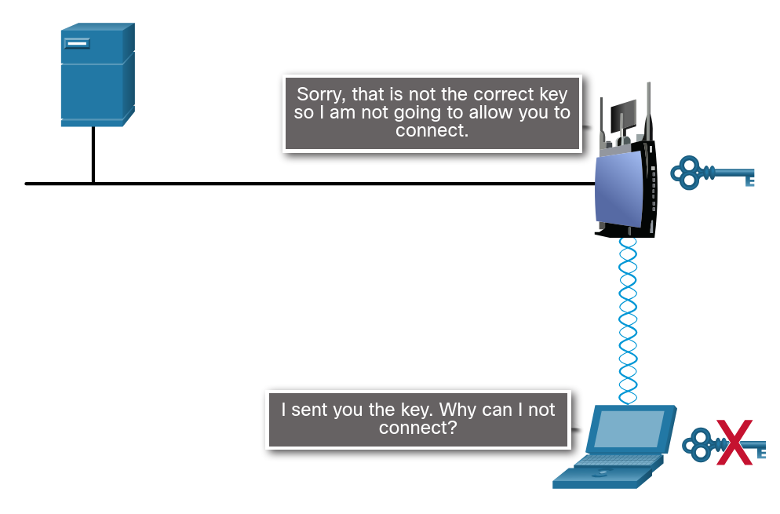

# Module 3: Wireless and Mobile Networks

## Wireless Networks

A wireless network is a computer network that uses wireless data connections
between network nodes

### Types of wireless networks

- Wireless PAN (e.g., Bluetooth, NFC)
- Wireless LAN (e.g., WiFi)
- Wireless ad-hoc network
- Wireless MAN
- Wireless WAN (e.g., GPS)
- Cellular network
- Global area network
- Space network

## Mobile Device Connectivity

### Mobile Devices and Wi-Fi

- Mobile devices give us the freedom to work, learn, play, and communicate wherever we want. People using mobile devices do not need to be tied to a physical location to send and receive voice, video, and data communications.
- In addition, wireless facilities, such as internet cafes, are available in many countries.
- College campuses use wireless networks to allow students to sign up for classes, watch lectures, and submit assignments in areas where physical connections to the network are unavailable.
- With mobile devices becoming more powerful, many tasks that needed to be performed on large computers connected to physical networks can now be completed using mobile devices on wireless networks.
- Almost all mobile devices are capable of connecting to Wi-Fi networks.
- It is advisable to connect to Wi-Fi networks when possible because data used over Wi-Fi does not count against the cellular data plan.
- Also, because Wi-Fi radios use less power than cellular radios, connecting to Wi-Fi networks conserves battery power.
- Like other Wi-Fi-enabled devices, it is important to use security when connecting to Wi-Fi networks.
- These precautions should be taken to protect Wi-Fi communications on mobile devices:
  - Never send login or password information using unencrypted text (plaintext).
  - Use a VPN connection when possible if you are sending sensitive data.
  - Enable security on home networks.
  - Use WPA2 or higher encryption for security.

### Wi-Fi Settings

- Two of the most popular operating systems for mobile devices are **Android** and **Apple iOS**.
- Each operating system has settings that enable you to configure your device to connect to wireless networks.

### Configure Mobile Wi-Fi Connectivity

- If your mobile device does not prompt to connect to a Wi-Fi network, the network SSID broadcast may be turned off, or the device may not be set to connect automatically.
- Manually configure the Wi-Fi settings on the mobile device.
- Remember that SSIDs and passphrases must be typed exactly as entered on the wireless router setup or the device will not connect properly, as shown in the figure.
- **SSID** is the name assigned to a wireless network.
- **Passphrase** is what we normally use as the “wireless password”.



- To connect to a Wi-Fi network manually on an **Android device**, follow these steps:

```text
Step 1. Select Settings > Add network.
Step 2. Enter the network SSID.
Step 3. Touch Security and select a security type.
Step 4. Touch Password and enter the password.
Step 5. Touch Save.
```

> [!IMPORTANT]
> Operating systems for mobile devices are updated frequently and may be
> customized by the device manufacturer.
> The commands listed above may not be exactly the same on your device.
> There are online manuals for every type of device which are usually accessible
> from the website of the manufacturer.

- To connect to a Wi-Fi network manually on an **iOS device**, follow these steps:

```text
Step 1. Select Settings > Wi-Fi > Other.
Step 2. Enter the network SSID.
Step 3. Touch Security and select a security type.
Step 4. Touch Other Network.
Step 5. Touch Password and enter the password.
Step 6. Touch Join.
```

### Configure Cellular Data Settings

- Cellular data plans are offered by most cell phone carriers, but the bandwidth limitations and charges for usage vary widely by carrier, and by plan within carriers.
- As a result, many mobile device users only use their cellular data plans when Wi-Fi service is not available.

- To turn on or off cellular data on an Android device, as shown in the figure, use the following path:

```text
Settings > touch More under Wireless and Networks > touch Mobile Networks > touch Data enabled
```

- To turn on or off cellular data on an iOS device, as shown in the figure, use the following path:

```text
Settings > Cellular Data > turn cellular data on or off
```

- Mobile devices are preprogrammed to use a Wi-Fi network for internet if one is available and the device can connect to the access point and receive an IP address.

> [!NOTE]
> If no Wi-Fi network is available, the device uses the cellular data capability if it is configured.
> Most of the time, transitions from one network to another are not obvious to the user.
> For example, as a mobile device moves from an area of 4G coverage to 3G coverage, the 4G radio
> shuts off and turns on the 3G radio. Connections are not lost during this transition.

### Video - Bluetooth Configuration on a Windows Laptop

[Pair a Bluetooth device in Windows](https://support.microsoft.com/en-us/windows/pair-a-bluetooth-device-in-windows-2be7b51f-6ae9-b757-a3b9-95ee40c3e242)

### Simple Connectivity with Bluetooth

- Mobile devices connect using many different methods. Cellular and Wi-Fi can be difficult to configure, and require extra equipment such as towers and access points.
- Cable connections are not always practical when connecting headsets or speakers.
- Bluetooth technology provides a simple way for mobile devices to connect to each other and to wireless accessories.
- Bluetooth is wireless, automatic, and uses very little power, which helps conserve battery life.
- Up to eight Bluetooth devices can be connected together at any one time.
- These are some examples of how devices use Bluetooth:
  - Hands-free headset - A small earpiece with a microphone can be used for making and receiving calls.
  - Keyboard or mouse - A keyboard or mouse can be connected to a mobile device to make input easier.
  - Stereo control - A mobile device can connect to a home or car stereo to play music.
  - Car speakerphone - A device that contains a speaker and a microphone can be used for making and receiving calls.
  - Tethering - A mobile device can connect to another mobile device or computer to share a network connection. Tethering can also be performed with a Wi-Fi connection or a cable connection such as USB.
  - Mobile speaker - Portable speakers can connect to mobile devices to provide high-quality audio without a stereo system.

### Bluetooth Pairing

- Bluetooth pairing occurs when two Bluetooth devices establish a connection to share resources.
- In order for the devices to pair, the Bluetooth radios are turned on, and one device begins searching for other devices.
- Other devices must be set to discoverable mode, also called visible, so that they can be detected.
- When a Bluetooth device is in discoverable mode, it transmits the following information when another Bluetooth device requests it:
  - Name
  - Bluetooth class
  - Services that the device can use
  - Technical information, such as the features or the Bluetooth specification that it supports

- During the pairing process, a personal identification number (PIN) may be requested to authenticate the pairing process.
- The **PIN** is often a number, but can also be a numeric code or passkey.
- The PIN is stored using **pairing services**, so it does not have to be entered the next time the device tries to connect.
- This is convenient when using a headset with a smart phone, because they are paired automatically when the headset is turned on and within range.

- To pair a Bluetooth device with an Android device, follow these steps:

```text
Step 1. Follow the instructions for your device to place it in discoverable mode.
Step 2. Check the instructions for your device to find the connection PIN.
Step 3. Select Settings > Wireless and networks.
Step 4. Touch Bluetooth to turn it on.
Step 5. Touch the Bluetooth tab.
Step 6. Touch Scan for devices.
Step 7. Touch the discovered device to select it.
Step 8. Type the PIN.
Step 9. Touch the device name again to connect to it.
```

- To pair a Bluetooth device with an iOS device, follow these steps:

```text
Step 1. Follow the instructions for your device to place it in discoverable mode.
Step 2. Check the instructions for your device to find the connection PIN.
Step 3. Select Settings > Bluetooth.
Step 4. Touch Bluetooth to turn it on.
Step 5. Touch the discovered device to select it.
Step 6. Type the PIN.
```

> [!NOTE]
> Remember that mobile device operating systems are updated frequently.
> Always refer to the documentation of the manufacturer for your specific model
> device for the latest command reference.
