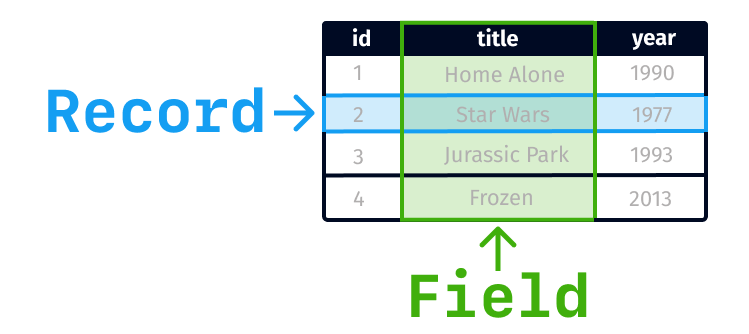
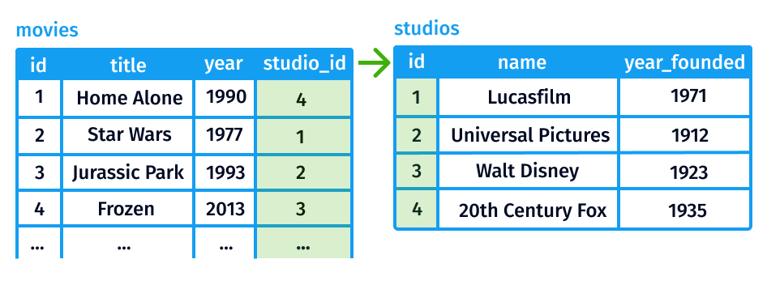
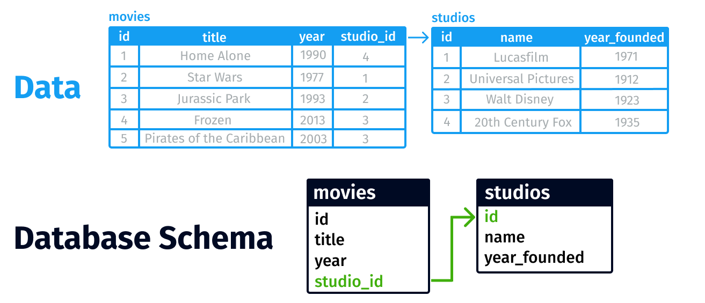
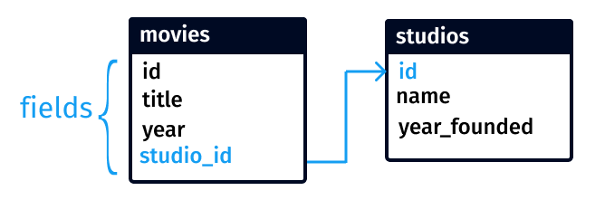
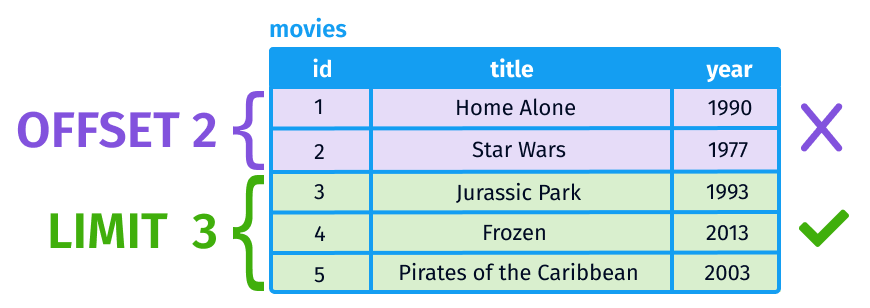

# SQL Notes

- SQL stands for **Structured Query Language**.
- Spreadsheets: e.g Excel.
- SQL code is used to send requests to a database. These requests are known as **queries**.
- Most databases collect data in **tables**. Tables organize data in records and fields.
   - A **record** (row) contains information about a subject such as a particular employee, a customer or a product like a movie. - A **field** (column) contains information about the subjects such as name, email or product release year. - The **header** row is the top row of a table and includes the names for the different fields (columns).
  ⭐ SQL allows you to work with data stored in a database
  ⭐ The SELECT query is used to get data from a table

---

- Data that can be stored in tables is called **structured data**.
- **Unstructured** data is information that is difficult to store in tables (e.g audio file).
  ⭐ Data can come from different **sources**
  ⭐ Data can be classified into **structured** or **unstructured**

---

- The **relational database** is the most common type of database. The image shows a relational database.
  
- The different tables in a relational database connect to each other using fields (columns) with values in common. These fields are called **keys**.
- A relational database stores data in **tables**. so it can handle Structured data.
- The different tables in a relational database have unique names. The name of the table you want to access data **FROM** needs to be included in the SQL query.
  ⭐ **relational databases** store information in interconnected tables
  ⭐ **keys** connect tables in a relational database
  ⭐ you can query data **FROM** different tables in the database

---

- A **schema** is a visual representation of how a database is organized, showing its tables, fields and keys. Arrows are used to show how the different tables are related.
  
  
- The _ symbol allows you to select **all the fields** in a table. This way you can avoid typos when listing field names. (e.g `SELECT _`).
  ⭐ Bugs in queries cause error messages
  ⭐ The schema of a database helps you avoid errors
  ⭐ SQL queries are organized in different lines so they are easier to read by humans

---

- To explain their SQL queries, data professionals use **comments.** (`--Comment`).
- If you need to make comments with multiple lines, you can use  **`/* … */` block comments**.
- SQL code is case-insensitive for **command words** like SELECT (select) and FROM (form).
- Data professionals use uppercase for the SQL command words and lowercase for tables and fields names. This makes the SQL code easier to read and consistent across projects.
- Line breaks are ignored by computers. Same thing happens with extra whitespaces.
  ⭐ You can add **comments** to your code with the **double hyphens** (**--**)
  ⭐ You can add a **block comment** with **/_ … _/**
  ⭐ SQL is a **case-insensitive** language.

---

- The **ORDER BY** command is used to sort the extracted data in the results table.
- Data is sorted by fields.
- By default the ORDER BY command sorts the data in ascending order (`ASC`)
- If you need the data sorted in descending order (from largest to smallest) you need to add the `DESC` keyword.
  ⭐ You can sort extracted data with the **ORDER BY** command
  ⭐ **DESC** sorts data in descending order (from largest to smallest, or Z to A)
  ⭐ **ASC** sorts data in ascending order (from smallest to largest, or A to Z)

---

- The `LIMIT` command reduces the number of records in the results table
- `LIMIT` is usually combined with `ORDER BY` to extract the records that rank the highest/lowest.
- `LIMIT` is applied as the last operation. The results will be sorted first, then limited.
- The `OFFSET` parameter is used with `LIMIT` to skip a number of records.
  
  ⭐ `LIMIT` is used to reduce the number of records in a results table
  ⭐ `OFFSET` skips a number of records
  ⭐`ORDER BY` can be combined with `LIMIT` and `OFFSET`

---

## Pattern Matching

- The % special symbol is known as a **wildcard** and is used to create patterns.
- The % symbol stands for any number of characters, including zero characters.
- You can use patterns to extract email addresses that share the same domain.
- LIKE is used to filter strings, so you must enclose the pattern in **single quotes ' '**.
- Patterns with the LIKE operator are case-sensitive in most database systems. This means that the pattern will treat uppercase and lowercase characters as different.
  ⭐ LIKE is used to search for patterns in string fields
  ⭐ LIKE patterns are case-sensitive
  ⭐ When a string field contains numbers, they are treated as characters
- The **underscore symbol \_** is another wildcard and represents 1 single character only.
- You can include multiple queries in your SQL code. You just need to separate them with a **semicolon(;)**
- **LOWER()** and **UPPER()** commands are used to convert strings to lower or uppercase.
- Use LOWER (or UPPER) with LIKE in the WHERE command line for **case-insensitive pattern matching**

```sql
 SELECT title FROM books
 WHERE LOWER(title) LIKE '%cooking%'
```

⭐ the **underscore \_ wildcard** represents any single character in a pattern
⭐ You can use **UPPER()** and **LOWER()** commands to perform **case-insensitive pattern searches**.

---

## SQL Conditions

---

## Data Aggregation

- The `MIN()` function returns the smallest value of the selected column.
- The `MAX()` function returns the largest value of the selected column.
- Example:

```sql
-- Find the lowest price in the Price column
SELECT MIN(Price)
FROM Products;
```

- The `COUNT()` function returns the number of rows that matches a specified criterion.
- Example:

```sql
-- Find the total number of rows in the `Products` table
SELECT COUNT(*)
FROM Products;
```

- The `SUM()` function returns the total sum of a numeric column.
- Example:

```sql
-- Return the sum of all `Quantity` fields in the `OrderDetails` table
SELECT SUM(Quantity)
FROM OrderDetails;
-- Give the summarized column a name by using the `AS` keyword (Alias).
SELECT SUM(Quantity) AS total
FROM OrderDetails;
```

- The `AVG()` function returns the average value of a numeric column.
- Example:

```sql
-- Find the average price of all products
SELECT AVG(Price)
FROM Products;
-- Note: NULL values are ignored.
```

⭐ **aggregation operations** summarize data to produce 1 single numerical value
⭐ **MAX()**, **MIN()**, **COUNT()**, **SUM()** and **AVG()** are examples of aggregation operations

---
