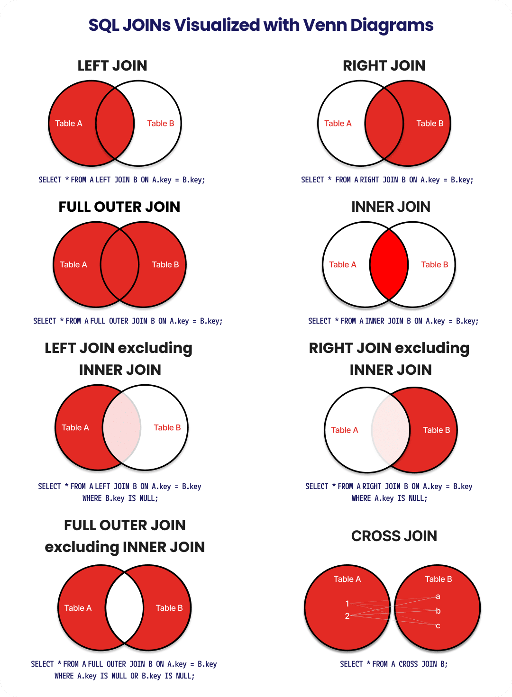

# SQL – Oracle Cheatsheet

## LDD (Langage de Définition des Données / DDL)

Commands used to **create and modify database objects**.

### CREATE

Create database objects such as tables, views, sequences, indexes.

```sql
CREATE TABLE employees (
    id NUMBER PRIMARY KEY,
    name VARCHAR2(100),
    salary NUMBER,
    hire_date DATE
);
```

### ALTER

Modify an existing object.

```sql
ALTER TABLE employees
ADD email VARCHAR2(100);

ALTER TABLE employees
MODIFY salary NUMBER(10,2);
```

### DROP

Delete an object permanently.

```sql
DROP TABLE employees;
```

### Constraints

Constraints ensure **data integrity**.

#### Default

```sql
salary NUMBER DEFAULT 0
```

#### NOT NULL

```sql
name VARCHAR2(100) NOT NULL
```

#### PRIMARY KEY

Unique identifier of a table.

```sql
id NUMBER PRIMARY KEY
```

#### FOREIGN KEY

Relationship between tables.

```sql
department_id NUMBER,
CONSTRAINT fk_dept
FOREIGN KEY (department_id)
REFERENCES departments(id)
```

#### UNIQUE

Ensures unique values.

```sql
email VARCHAR2(100) UNIQUE
```

#### CHECK

Ensures a condition is respected.

```sql
salary NUMBER CHECK (salary > 0)
```

> [!NOTE]
> Column-level constraints:
>
> - Must be defined at column level.
> - Used when the constraint concerns **only one column**.

Example:

```sql
  CREATE TABLE employees (
    id NUMBER PRIMARY KEY,
    name VARCHAR2(100) NOT NULL,
    salary NUMBER CHECK (salary > 0)
  );
```

> [!NOTE]
> Column or Table level constraints:
>
> - At column level, or
> - At table level when needed.

Example:

```sql
CREATE TABLE employees (
    id NUMBER,
    email VARCHAR2(100),
    CONSTRAINT emp_pk PRIMARY KEY (id)
);
```

> [!NOTE]
> Table-level constraints:
>
> - Must be defined at table level when the constraint depends on two or more columns.

Example:

```sql
CREATE TABLE enrollment (
    student_id NUMBER,
    course_id NUMBER,
    CONSTRAINT pk_enrollment
    PRIMARY KEY (student_id, course_id)
);
```

### Views

Virtual tables based on queries.

```sql
CREATE OR REPLACE VIEW v_employees AS
SELECT name, salary
FROM employees;
```

Options:

```sql
WITH READ ONLY
WITH CHECK OPTION
FORCE
```

### Sequences

Used to generate automatic numbers.

```sql
CREATE SEQUENCE seq_employee
START WITH 1
INCREMENT BY 1
MINVALUE 1
MAXVALUE 999999
CACHE 20
CYCLE;
```

Usage:

```sql
seq_employee.NEXTVAL
seq_employee.CURRVAL
```

## LMD (Langage de Manipulation des Données / DML)

Commands used to **manipulate data**.

### INSERT

```sql
INSERT INTO employees (id, name, salary)
VALUES (1, 'John', 3000);
```

### UPDATE

```sql
UPDATE employees
SET salary = 3500
WHERE id = 1;
```

### DELETE

```sql
DELETE FROM employees
WHERE id = 1;
```

## LID (Langage d’Interrogation des Données / DQL)

Commands used to **query data**.

### SELECT Syntax

Execution order:

1. SELECT
2. FROM
3. ON
4. WHERE
5. GROUP BY
6. HAVING
7. ORDER BY

Example:

```sql
SELECT name, salary
FROM employees
WHERE salary > 2000
ORDER BY salary DESC;
```

## Aggregate Functions (Fonctions de groupe)

```sql
COUNT()
SUM()
AVG()
MIN()
MAX()
STDDEV()
VARIANCE()
```

Example:

```sql
SELECT AVG(salary)
FROM employees;
```

## Date Functions

```sql
SYSDATE
ADD_MONTHS(date, n)
MONTHS_BETWEEN(date1, date2)
NEXT_DAY(date, 'MONDAY')
LAST_DAY(date)
EXTRACT(YEAR FROM date)
```

Example:

```sql
SELECT SYSDATE FROM dual;
```

## Date Formats

| Format | Meaning             |
| ------ | ------------------- |
| d      | day of week (1–7)   |
| dd     | day of month (1–31) |
| ddd    | day of year (1–366) |
| w      | week of month       |
| ww     | week of year        |
| mm     | month (1–12)        |
| yyyy   | year                |
| hh     | hour (1–12)         |
| hh24   | hour (0–23)         |
| mi     | minutes             |
| ss     | seconds             |

Example:

```sql
SELECT TO_CHAR(SYSDATE, 'DD/MM/YYYY') FROM dual;
```

## String Functions

```sql
SUBSTR()
LTRIM()
RTRIM()
TRIM()
INSTR()
LPAD()
RPAD()
CONCAT()
REPLACE()
TRANSLATE()
```

Example:

```sql
SELECT SUBSTR(name,1,3)
FROM employees;
```

## Numeric Functions

```sql
ROUND()
TRUNC()
FLOOR()
CEIL()
MOD()
```

Example:

```sql
SELECT ROUND(125.567,2)
FROM dual;
```

## Conditional Functions

```sql
NVL()
NVL2()
NULLIF()
COALESCE()
CASE
```

Example:

```sql
SELECT NVL(commission,0)
FROM employees;
```

## Analytical / Ranking Functions

```sql
ROW_NUMBER()
RANK()
DENSE_RANK()
```

Example:

```sql
SELECT name,
       RANK() OVER (ORDER BY salary DESC)
FROM employees;
```

## Set Operators

Combine results of multiple queries.

```sql
UNION
UNION ALL
INTERSECT
MINUS
```

Example:

```sql
SELECT id FROM table1
UNION
SELECT id FROM table2;
```

## Joins



### CROSS JOIN

Cartesian product.

```sql
SELECT *
FROM employees
CROSS JOIN departments;
```

### NATURAL JOIN

```sql
SELECT *
FROM employees
NATURAL JOIN departments;
```

### INNER JOIN

```sql
SELECT *
FROM employees e
INNER JOIN departments d
ON e.dept_id = d.id;
```

### LEFT JOIN

```sql
SELECT *
FROM employees e
LEFT JOIN departments d
ON e.dept_id = d.id;
```

### RIGHT JOIN

```sql
SELECT *
FROM employees e
RIGHT JOIN departments d
ON e.dept_id = d.id;
```

### FULL JOIN

```sql
SELECT *
FROM employees e
FULL JOIN departments d
ON e.dept_id = d.id;
```
