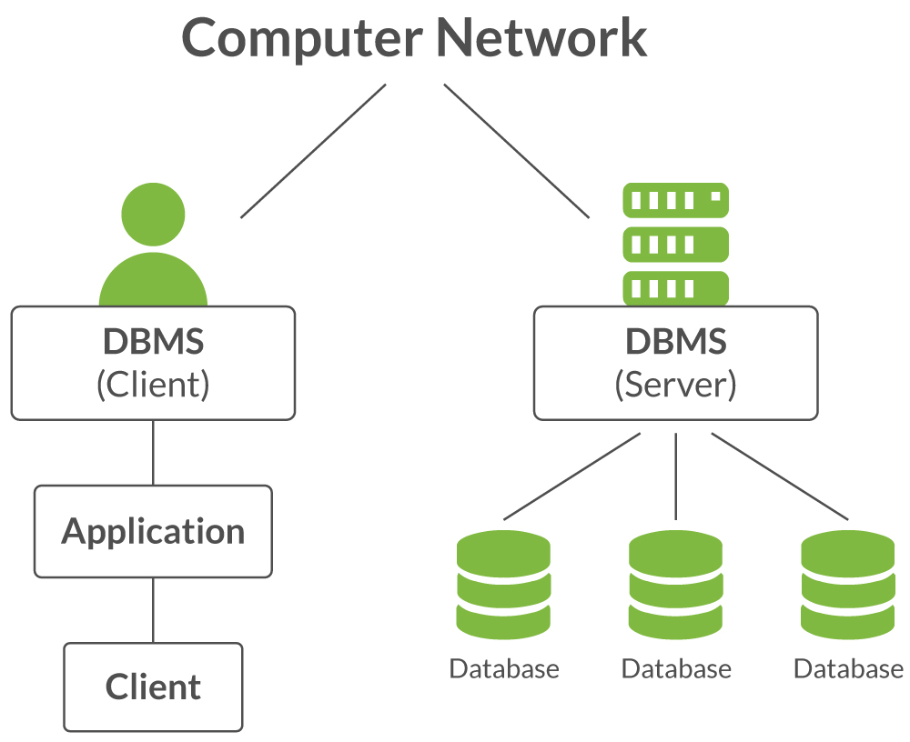
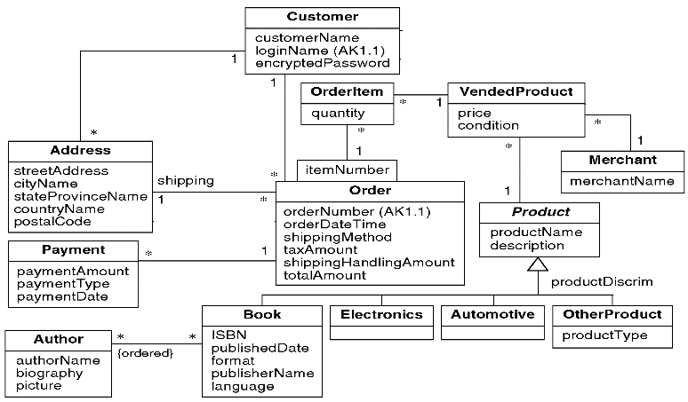

# SQL Terms

## DBMS

A database management system (DBMS) is **a software system for creating and managing databases**. A DBMS enables end users to create, protect, read, update and delete data in a database.
Some DBMS examples include **MySQL, PostgreSQL, Microsoft Access, SQL Server, FileMaker, Oracle, RDBMS, dBASE, Clipper, and FoxPro**.
- **Note:** <mark>**MS Excel is not a database program**.</mark>

---
## CDM

A conceptual schema or conceptual data model is a high-level description of informational needs underlying the design of a database. It typically includes only the core concepts and the main relationships among them. This is a high-level model with insufficient detail to build a complete, functional database.
