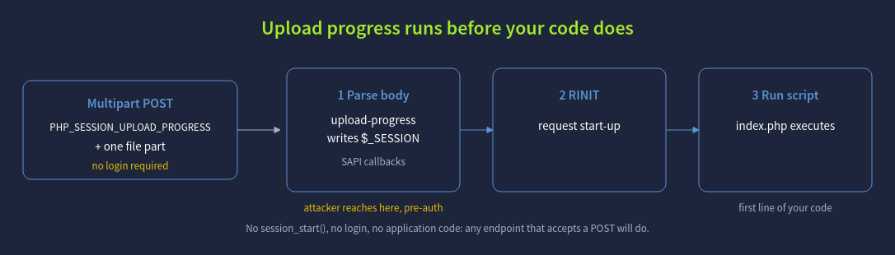
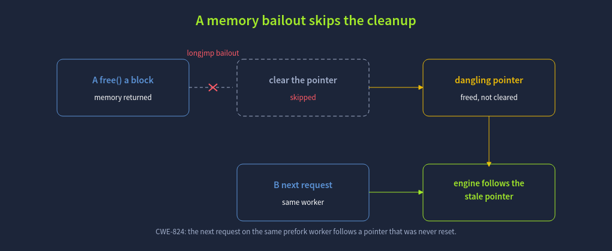
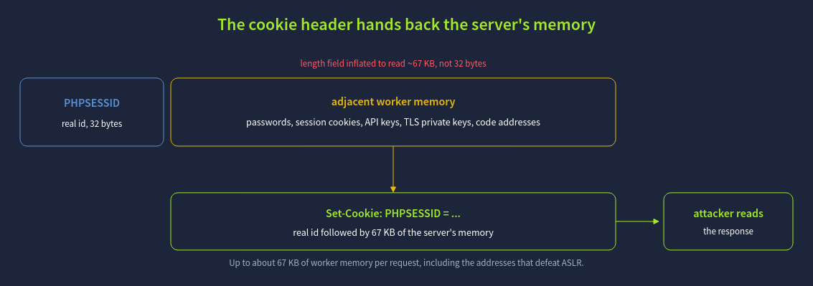
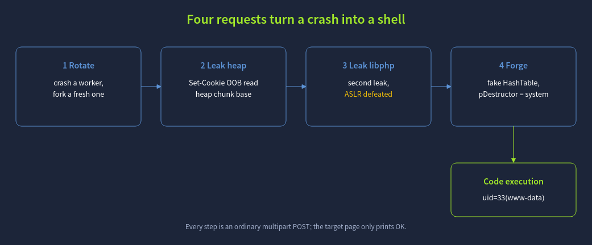

# PHP2Shell

## A Harmless Feature: Upload Progress

Parsing the request body is one of the first things PHP does, long before it initialises the request environment and long before it compiles and runs the script the URL points at. The progress updates are written from inside the body-parsing callbacks, so they occur **before any application code executes**. That has a consequence the feature's designers never intended to expose: reaching this code needs no
`session_start()` in the target page, no valid login, and in fact no application logic at all. Any URL on the server that accepts a POST request is enough, even one whose script does nothing but print a single line.

This pre-execution window is the foothold. The whole of PHP2Shell happens inside it, driven entirely by what the attacker puts in an ordinary multipart upload, while the application that owns the server is still fast asleep.

## The Bug: A Bailout at the Wrong Moment

The upload-progress feature is not itself the vulnerability. The vulnerability is what happens when PHP runs **out of memory** while that feature is in the middle of its work, and to see it you need to know how PHP handles a fatal error.

PHP caps how much memory a single request may use with the `memory_limit` setting. When a request tries to exceed it, PHP cannot simply carry on, so it performs what the engine calls a **bailout**: it uses a `longjmp()` to jump straight back to a safe recovery point, abandoning whatever it was doing. This is the mechanism behind the familiar "Allowed memory size exhausted" fatal error. Normally a request tidies up after itself, freeing memory and clearing the pointers that referred to it, but a bailout skips all of that. It is an emergency exit, not an orderly shutdown.

The flaw is a matter of timing. If the out-of-memory condition strikes after the engine has freed a block of memory but before it has cleared the pointer that still refers to that block, the bailout leaves the pointer behind, pointing at memory that is no longer valid. This is a classic dangling pointer, classified as **CWE-824: Access of Uninitialised Pointer**.

On its own, a dangling pointer in a request that has just died would be harmless, because the request is over. What makes it dangerous is the server model. Under Apache's **prefork** configuration with `mod_php`, a single worker process serves one request after another without restarting between them. The stale pointer therefore does not vanish with the failed request; it stays in the worker's memory, and the next request to land on that same worker finds the engine reaching through a pointer it never reset. An attacker who controls what gets allocated into that freed space in the second request controls what the pointer now points at.

From this single defect the researchers built two distinct attacks, which is why PHP2Shell carries two CVE numbers. **CVE-2026-109618** is a memory-disclosure flaw: the stale pointer is read back as a string with an attacker-influenced, oversized length, and PHP returns the result in a response header, handing the attacker a window into the worker's memory. **CVE-2026-109619** is the remote-code-execution flaw, which turns the corrupted state into control over the program's flow. The PHP changelog addresses both with a single description, "Avoid state corruption via bailout", which names the root cause precisely. The next three tasks follow that chain in order: confirm the target, use the disclosure to defeat ASLR, and then turn the corruption into a shell.

## Leaking Memory and Defeating ASLR (CVE-2026-109618)

Modern systems load code and data at randomised addresses, a defence called **A**ddress **S**pace **L**ayout **R**andomisation (ASLR). An attacker who wants to redirect execution has to know where things actually are in memory, and ASLR is meant to deny that knowledge. `CVE-2026-109618` removes it, by turning the dangling pointer into a leak of the worker's own memory.

The mechanism reuses the bailout from the previous task. An out-of-memory condition is provoked while a session identifier is being handled, which leaves a stale pointer to the session id. A following request reoccupies that freed space so the stale pointer now describes a string whose length the attacker has inflated far beyond the real data. When PHP sends the session cookie, it reads that oversized session-id string and returns it to the client in the **Set-Cookie: PHPSESSID** response header. The header now carries whatever happened to sit in the worker's memory after the string, which the research measured at up to roughly 67 KB of process memory per request. In a real deployment that memory can hold other users' passwords, session cookies, API keys, and even TLS private keys; for the exploit, it holds the addresses it needs.

The exploit runs this leak twice. The first pass discloses the base address of PHP's memory heap, and the second discloses the base address of the PHP library (`libphp`) by reading a pointer whose offset into the library is known. Between them, the two leaks tell the attacker exactly where the heap and the engine's own code live in this specific worker, which is all that was missing to defeat ASLR.

## From a Leak to a Shell (CVE-2026-109619)

The leak told the attacker where everything is. `CVE-2026-109619` is what turns that knowledge into a command running on the server. It works by reoccupying the freed memory not with data to read, but with a carefully forged object that hijacks the engine's own clean-up machinery.

When PHP destroys a value, it may call a function pointer stored alongside it, a destructor, to release the value's resources. The exploit reoccupies the dangling reference with a forged internal structure (a `HashTable`) whose destructor pointer, `pDestructor`, has been set to the address of `system()`
inside the PHP library, an address the leak in the previous task made known. When the engine tidies up that value at the end of request handling, it believes it is calling a harmless destructor and instead calls `system()` with attacker-controlled bytes as its argument. The command runs as the web server user. Nothing in the attack needs the C library or any gadget outside PHP itself; the whole finish is built from the engine's own code.

## Detection, Mitigation and the Real Fix

Because PHP2Shell lives in the runtime, the instinct to "update the website" misses it entirely. Updating WordPress, Drupal, Joomla or Laravel changes the application; the vulnerable code is in PHP, underneath all of them. The only complete fix is to patch the PHP runtime itself, by updating the PHP package your distribution ships or the base image your container is built from, to `8.5.12`, `8.4.27`, `8.3.36` or `8.2.35`, and then restarting every worker so no process keeps running the old code.

Until that patch can be applied, several interim measures reduce exposure, though the PHP team is clear that none is a complete substitute for patching. Disabling the feature the attack relies on, by setting `session.upload_progress.enabled = 0` and restarting all workers, removes the trigger for most of the reported techniques. Turning off the opcode cache with `opcache.enable = 0` frustrates the code-execution path. On PHP 8.5, `fatal_error_backtraces = 0` addresses CVE-2026-109619 specifically. At the network edge, rejecting `multipart/form-data` requests blocks the delivery mechanism, at the cost of breaking legitimate file uploads. Running the PHP process with least privilege limits what an attacker gains if the chain does land.

One defence that does not help is worth calling out. A web application firewall that runs as a PHP module inspects traffic only once PHP hands control to the application, but this attack does its damage before the application ever runs. The malicious work is complete while the request is still being parsed, so an in-process filter never gets the chance to see it. Protection has to sit either in the patched runtime or at a layer in front of PHP.

For detection, the attack leaves distinctive marks. The disclosure path produces **abnormally large PHPSESSID values** in `Set-Cookie` response headers, which stand out sharply against the fixed-length identifiers PHP normally issues. The delivery requests are **large multipart POST bodies with very high field counts** that carry the `PHP_SESSION_UPLOAD_PROGRESS` field, and the memory exhaustion that drives the bug shows up as **PHP worker crashes and out-of-memory errors** in the logs. Any of these, and especially the combination, is worth alerting on while patching is in progress.

## Conclusion

PHP2Shell is a reminder that the software stack does not stop at the application. A single mistake in how the PHP engine recovered from running out of memory, present and unnoticed since 2012, exposed an unauthenticated path to code execution on a large share of the web's servers at once, independent of which framework or CMS sat on top. The lesson for defenders is to treat the runtime as part of the attack surface and to patch it with the same urgency as the application, because a flaw this deep cannot be reached by securing the layers above it.
