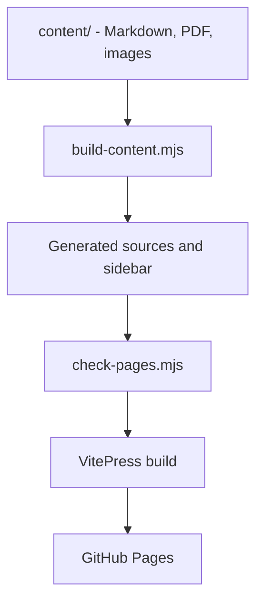

# Architecture

## Table of Contents

<!--toc:start-->

- [Architecture](#architecture)
  - [Overview](#overview)
  - [Repository Structure](#repository-structure)
  - [Build Pipeline](#build-pipeline)
  - [Content Types](#content-types)
  - [Technology Stack](#technology-stack)
  - [Design Principles](#design-principles)

<!--toc:end-->

## Overview

HashHashBooks is a content repository with a static website generator on top. Contributors only
add files under `content/`; the generator discovers them and publishes a site to GitHub Pages.



## Repository Structure

```text
content/                      all guides, books and notes - one folder per topic
  <topic>/                    kebab-case, e.g. cpp/, cybersecurity/, devops/
    README.md                 optional intro (becomes the topic page)
    notes.md links.md terms.md
    guides/                   *.md articles
    books/                    *.pdf
    cheatsheets/              *.pdf / images
    slides/                   *.pptx
    sources/                  *.tex
    assets/                   images used by the guides
    courses/                  course material (free layout)
    <sub-topic>/              same layout, any depth (e.g. cloud/aws/)
site/                         website generator (VitePress)
  scripts/build-content.mjs   scans content/ -> generates the site sources + sidebar
  scripts/check-pages.mjs     fails the build if a page would not compile
  scripts/lint-content.mjs    enforces the layout above
  site.config.json            title, repo, topic names, acronyms (see also .env.example)
res/                          logo (res/img), documentation (res/doc), Makefile modules (res/mk)
Makefile                      project automation: run `make help`
.github/                      workflows, templates, CODEOWNERS, community files
```

Every rule is checked by `make lint` (also run in CI), so the layout stays consistent as the
collection grows.

## Build Pipeline

| Step           | Script / Tool                | Purpose                                              |
| -------------- | ---------------------------- | ---------------------------------------------------- |
| Lint           | `scripts/lint-content.mjs`   | Enforce naming and folder conventions                |
| Generate       | `scripts/build-content.mjs`  | Scan `content/`, create pages, topic cards, sidebar  |
| Check          | `scripts/check-pages.mjs`    | Fail the build if a page would not compile           |
| Build          | VitePress                    | Produce the static site in `site/dist`               |
| Deploy         | `deploy-site.yml` workflow   | Publish to GitHub Pages on push to `main`            |

## Content Types

| File type                    | On the website                                             |
| ---------------------------- | ---------------------------------------------------------- |
| `.md`                        | Rendered page (`mermaid` diagrams too), sidebar, search    |
| images (`png`, `jpg`, `svg`) | Shown inside the pages that reference them                 |
| `pdf`                        | Built-in PDF viewer page (streamed from GitHub) + sidebar  |
| `zip`, `pptx`, ...           | Listed in the sidebar and folder pages, linked to GitHub   |
| new folder                   | New topic (home card + sidebar), no configuration required |

> Binaries are linked, not copied into the site, because GitHub Pages is limited to 1 GB and
> this repo holds ~1.5 GB of PDFs/zips.

## Technology Stack

- **Content:** Markdown, PDF, images
- **Site generator:** VitePress (Node.js)
- **Automation:** GNU Make, Node.js scripts
- **CI/CD:** GitHub Actions
- **Hosting:** GitHub Pages

## Design Principles

- Zero configuration for contributors: drop a file, push, done.
- Convention over configuration, enforced by linting.
- Large binaries are linked rather than duplicated.
- Standard Markdown only, so content stays portable.
